## What we build

**[herness](https://github.com/mak777uh/herness)** — a verification-first agent harness. An agent runs
inside an isolated room with its own kernel, no shell, and six tools with declared closures. Access
decisions are made by a policy, not by the code that uses it, and the policy is proved in Lean. Every
claim carries an evidence type, every gate can fail, and every gate is tested with a planted defect.

<picture>
  <source media="(prefers-color-scheme: dark)" srcset="https://raw.githubusercontent.com/mak777uh/mak777uh/main/assets/horse-run-dark.svg">
  
</picture>
